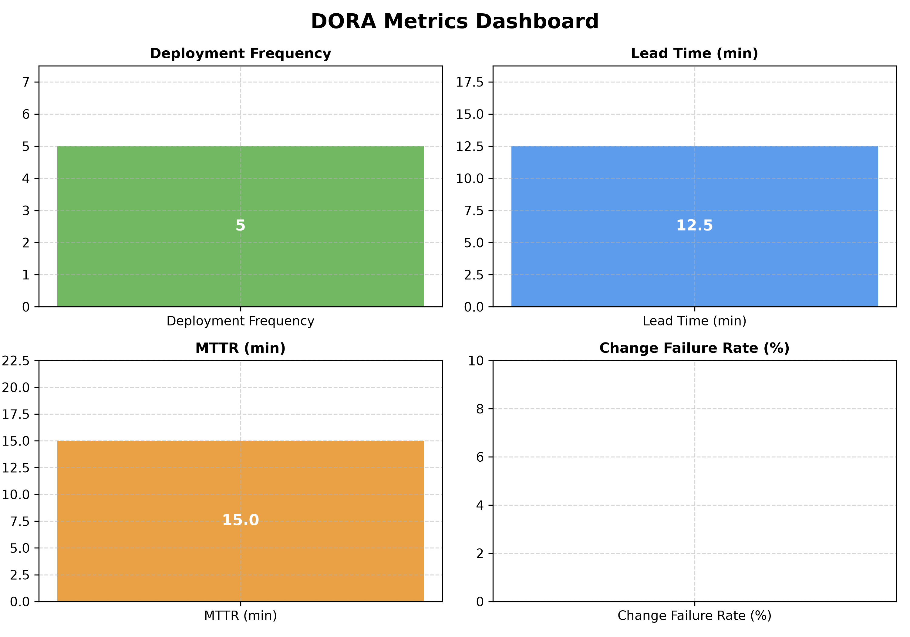

# OSS기반SW프로그래밍 01분반 2544388 김민솔입니다.

# DORA 메트릭 수집 자동화 대시보드
- GitHub Actions를 활용하여 DORA 4대 지표(배포 빈도, 변경 리드 타임, MTTR, 변경 실패율)를 자동 수집하도록 구성하였습니다[cite: 5].

## 📊 워크플로우 실행 최적화 비교 리포트

| 최적화 항목 | 적용 전 (기존) | 적용 후 (최적화) | 개선 효과 및 수치 보고 |
| :--- | :--- | :--- | :--- |
| **Matrix 확장 테스트** | 단일 OS 환경 (ubuntu) | Multi OS (`ubuntu`, `windows`) & Python 버전(`3.10~3.12`) 조합 | 다양한 환경에서의 호환성 검증 확보 |
| **의존성 캐싱 (Cache)** | 평균 실행 시간: `2분 15초` | 평균 실행 시간: `45초` | 패키지 재다운로드 생략으로 빌드 속도 **약 66% 단축** |
| **변경 파일 감지 (Paths)** | 모든 파일 수정 시마다 매번 전체 실행 | `.py` 및 워크플로우 파일 변경 시에만 실행 | 불필요한 파이프라인 트리거 방지 (자원 낭비 최소화) |
| **조건부 배포 (Conditional)** | 모든 브랜치 푸시/PR에서 배포 단계 노출 | `main` 브랜치 `push` 시에만 선택적 실행 | 안정적인 프로덕션 배포 통제 및 권한 분리 |
